# wM-Bus Gateway


This repository contains the source code for the **wM-Bus Gateway**, a device that integrates Wireless M-Bus media meters with other systems.

<p align="center">
    
    
    
</p>

---

## ℹ️ General Info

- 🟦 The gateway has two buttons:
  - **Top button** – switches pages on the display.
  - **Bottom button** – resets the device.
- 📶 The built-in LED blinks fast when the gateway receives a wM-Bus frame.

---

## 🏠 Getting Started with Home Assistant

> [!NOTE]
> This is the path we recommend if you are new to ESPHome. The gateway runs plain ESPHome, so any other way works too: for example, adopt it in ESPHome Device Builder and start from one of the [`blueprints`](blueprints).

You need:

- a computer with **Google Chrome** or **Microsoft Edge** and a USB cable for the gateway,
- **ESPHome Device Builder**. We recommend its [desktop app](https://esphome.io/install/) for Windows, macOS or Linux: it builds firmware on your computer, which is usually more powerful than the Home Assistant machine, and does not load Home Assistant.

### 1. Find your meters

Connect the antenna, then plug the gateway into your computer. Open the **wM-Bus Decoder** at [iotlabs.pl/tools](https://iotlabs.pl/en/tools#decoder) and click **Connect the Gateway**.

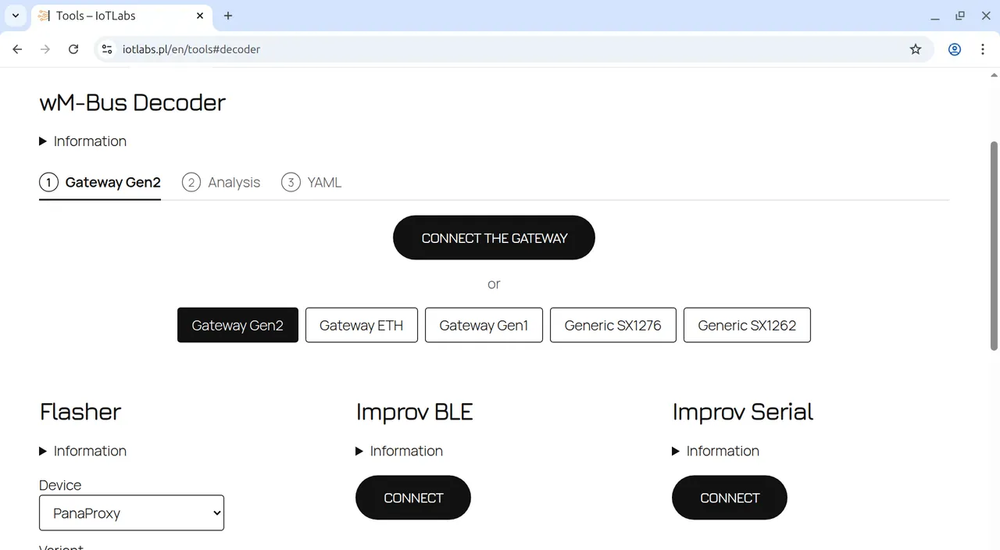

Choose the gateway's port (a *USB to UART* bridge) and click **Connect**. If the list has no such port, install the [driver of the gateway's USB chip](https://esphome.io/guides/physical_device_connection/#connecting-to-the-esp).

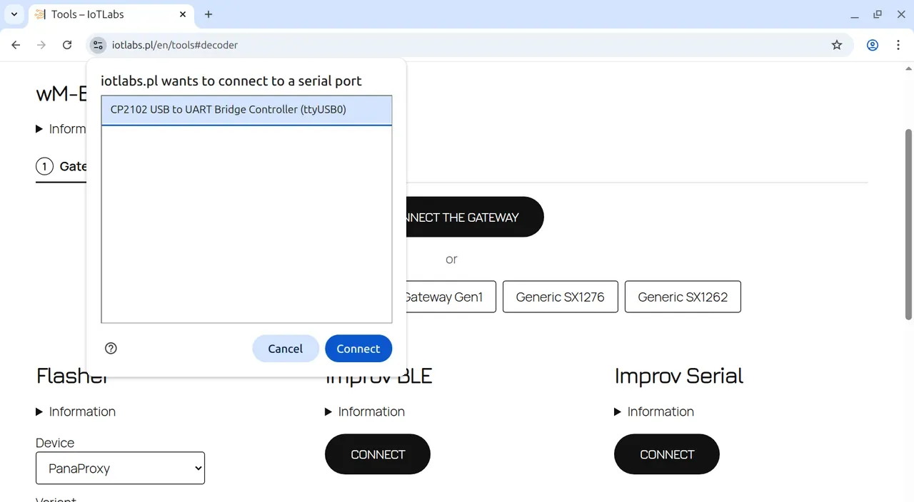

The gateway restarts, the decoder recognises its model and lists every meter it hears on the **Analysis** tab. Meters send their readings every few seconds to a few minutes, so give it a while. Find yours by the number printed on the meter, or by matching its consumption. A red padlock means the meter is encrypted.

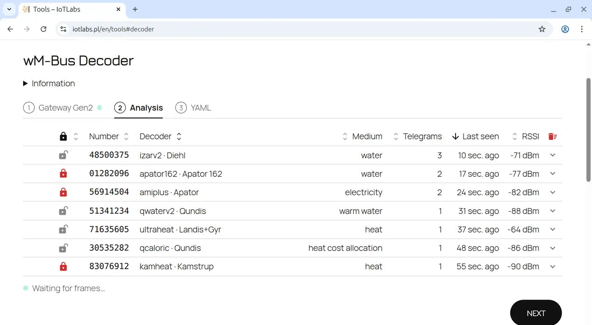

### 2. Choose the readings

Click your meter. The decoder picks its driver. If the meter is encrypted, enter its key; your utility company or the meter's installer has it. Then tick the readings you want:

- the first column sends a reading to Home Assistant,
- the second column shows it on the gateway's display.

Click the meter's name or a reading's name to change it. Do the same for every meter you want.

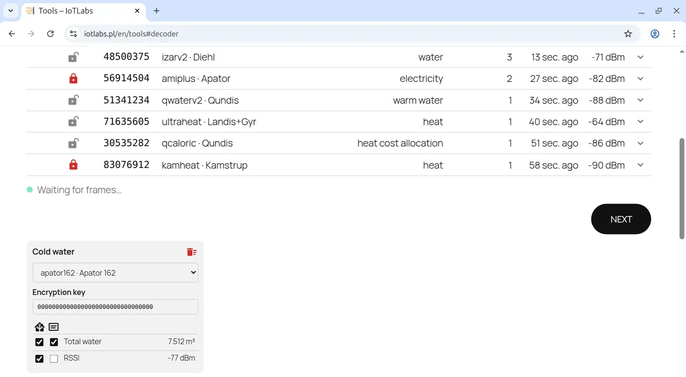

### 3. Copy the configuration

Click **Next**. The decoder writes the gateway's whole ESPHome configuration with your meters in it. Click **Copy**.

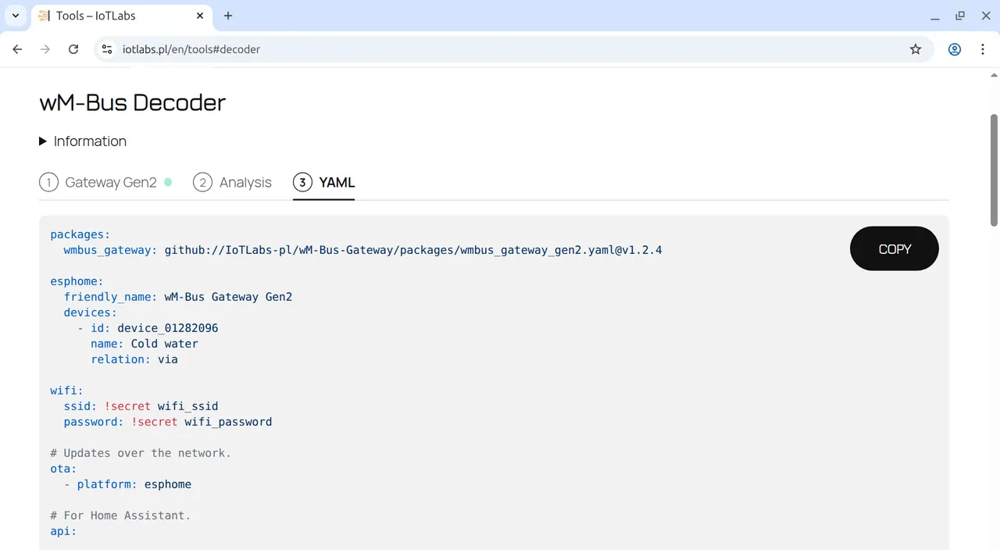

The decoder remembers your meters in this browser, so you can come back later and add more.

> [!IMPORTANT]
> Now release the gateway: go back to the first tab and click **Disconnect**, or close or refresh the page. ESPHome Device Builder can use the gateway's port only once the decoder lets go of it.

### 4. Create the gateway's configuration

Open ESPHome Device Builder, click **Create device**, open **Advanced set up options**, choose **Empty Configuration**, name the device and click **Finish setup**.

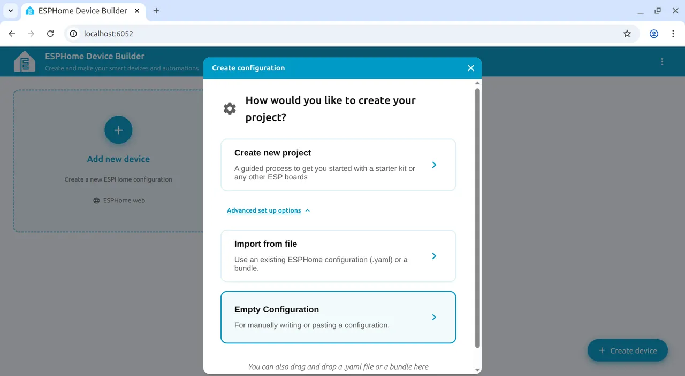

In the YAML editor, select everything, paste the configuration you copied and click **Save**. If the Device Builder reports `Secret 'wifi_ssid' not defined`, enter your Wi-Fi name and password in **⋮ → Set up Wi-Fi**.

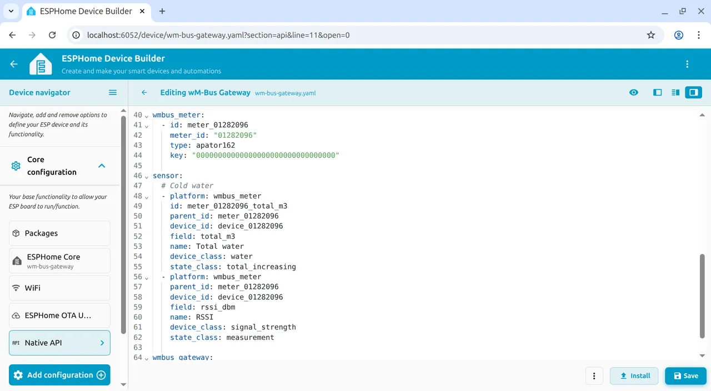

### 5. Install over USB

Click **Install**, choose **Plug into this computer**, then choose the gateway's port as in step 1. The Device Builder compiles the firmware and flashes it. The first build takes several minutes.

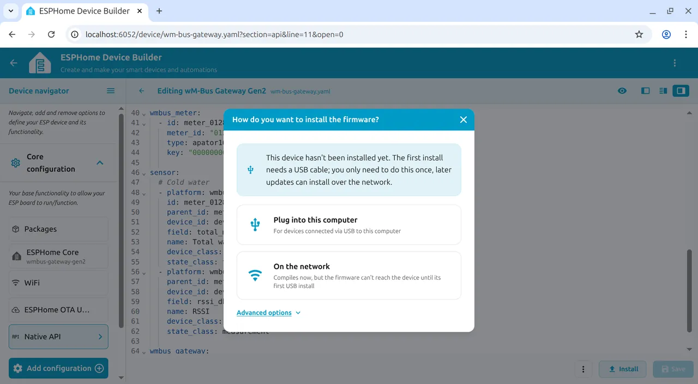

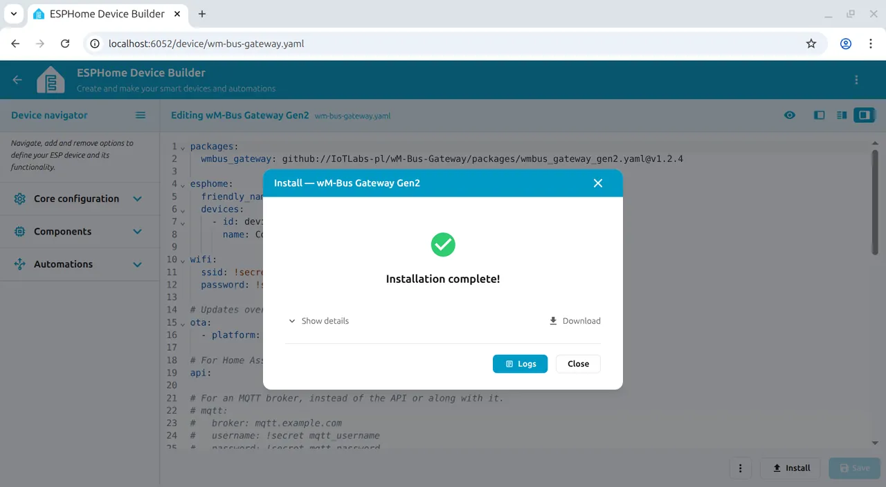

You can install later changes wirelessly (**On the network**), without the cable.

### 6. Add the gateway to Home Assistant

The gateway joins your network and Home Assistant discovers it. Go to **Settings → Devices & services**, click **Add** next to it and confirm with **Submit**.

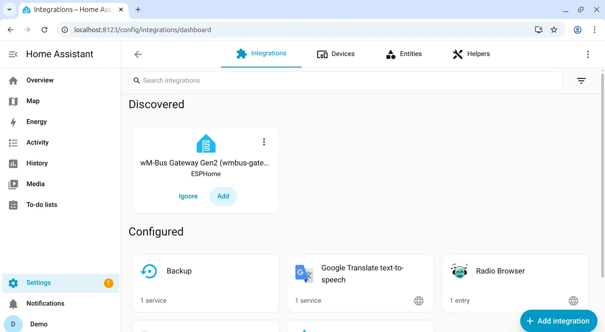

Each meter becomes a device with the readings you ticked.

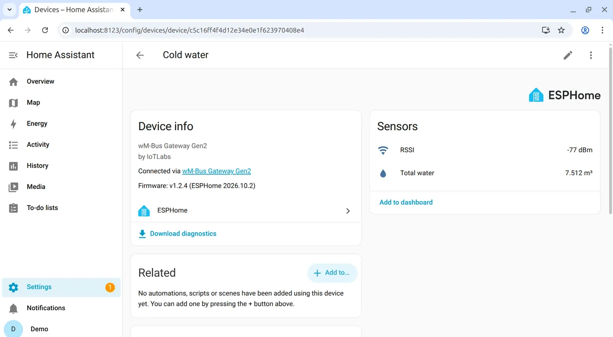

---

## ❓ FAQ

<details>
<summary>
<h3 style="display:inline-block">How do I add more meters?</h3>
</summary>

The gateway logs every frame it receives with a link to the decoder. To see the logs, click the **Logs** icon on the gateway's card in ESPHome Device Builder and choose **On the network**.

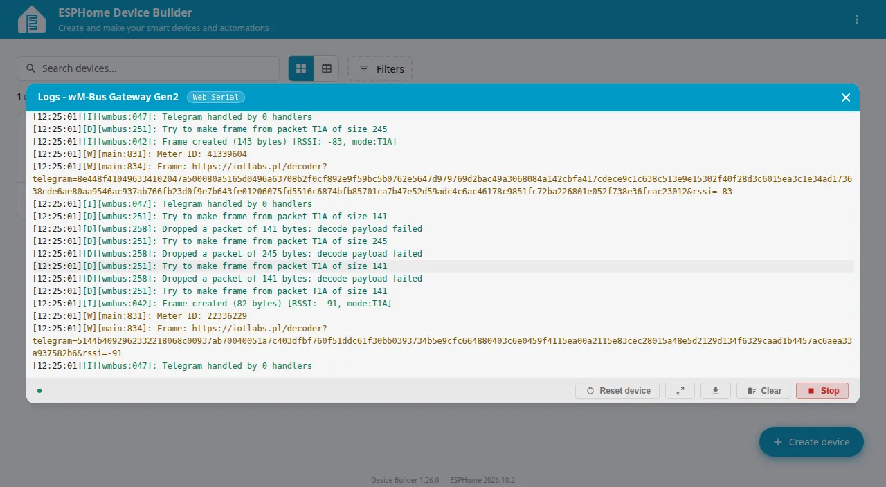

Open the link of the new meter's frame in the browser, or connect the gateway to the decoder over USB again as in step 1. Set up the meter in the decoder, copy the configuration, paste it over the old one as in step 4 and install it **On the network**.

If you changed the configuration by hand, the decoder does not know about it: copy only the new meter's sections instead.
</details>

<details>
<summary>
<h3 style="display:inline-block">How do I add sensors of the gateway itself, such as its Wi-Fi signal?</h3>
</summary>

The configuration from the decoder holds only the meters. Add ESPHome's own components to it, appending entries to the lists that are already there instead of adding a second `sensor:`:

```yaml
sensor:
  - platform: wifi_signal
    name: Wi-Fi signal
  - platform: uptime
    name: Uptime

text_sensor:
  - platform: wifi_info
    ip_address:
      name: IP address

button:
  - platform: restart
    name: Restart
```

Any other [ESPHome component](https://esphome.io/components/) goes in the same way.
</details>

<details>
<summary>
<h3 style="display:inline-block">How do I use the gateway as a Bluetooth proxy?</h3>
</summary>

Add these sections to the configuration and install it:

```yaml
esp32_ble_tracker:
  scan_parameters:
    active: true

bluetooth_proxy:
  active: true
```

Home Assistant then reaches Bluetooth devices near the gateway through it. See [Bluetooth Proxy](https://esphome.io/components/bluetooth_proxy/) for the details.
</details>

<details>
<summary>
<h3 style="display:inline-block">Where can I find an example ESPHome <code>yaml</code> configuration?</h3>
</summary>

The [`blueprints`](blueprints) directory has one for each variant. The decoder builds its configuration on them.
</details>

<details>
<summary>
<h3 style="display:inline-block">How to change unit of measurement?</h3>
</summary>
You can change the visible unit of measurement in the `sensor` section of the ESPHome configuration.  
For example, to change from `kWh` to `MWh`:

```yaml
unit_of_measurement: "MWh"
filters:
  - multiply: 0.001
```

This will adjust the value and display the correct unit.
</details>

<details>
<summary>
<h3 style="display:inline-block">How to change built-in LED settings?</h3>
</summary>

By default, the built-in LED blinks 10 times in one second when the gateway receives a wM-Bus frame. This blink is the `on_frame` automation with the id `frame_led_blink`.

To turn it off, remove it by this id. Add it to the `on_frame` list already in your configuration; your own automations there, such as the frame log, stay:

```yaml
wmbus_radio:
  on_frame:
    - id: !remove frame_led_blink
```

To blink in another pattern, remove it and add your own, for example two blinks of 500 ms:

```yaml
wmbus_radio:
  on_frame:
    - id: !remove frame_led_blink
    - then:
        - repeat:
            count: 2
            then:
              - light.turn_on: wmbus_gateway_status_led
              - delay: 500ms
              - light.turn_off: wmbus_gateway_status_led
              - delay: 500ms
```

To blink only for your meters, remove it and blink in each meter's `on_telegram`:

```yaml
wmbus_radio:
  on_frame:
    - id: !remove frame_led_blink

wmbus_meter:
  - id: my_meter
    ...
    on_telegram:
      - light.turn_on: wmbus_gateway_status_led
      - delay: 100ms
      - light.turn_off: wmbus_gateway_status_led
```

For patterns you reuse, see the [`script` component](https://esphome.io/components/script/).
</details>

---

### 🏭 Factory Reset

The **Flasher** at [iotlabs.pl/tools](https://iotlabs.pl/en/tools) installs the factory firmware. The same firmware is in the **Releases** as `wmbus-gateway-<variant>-<chip>.factory.bin`.

---

## 🌐 More Information

More info about the device can be found at:  
👉 [https://iotlabs.pl/en/wm-bus-gateway/](https://iotlabs.pl/en/wm-bus-gateway/)
